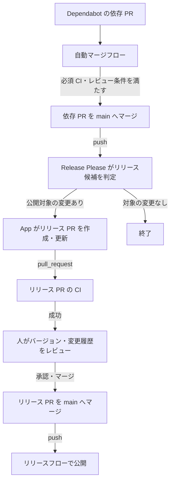
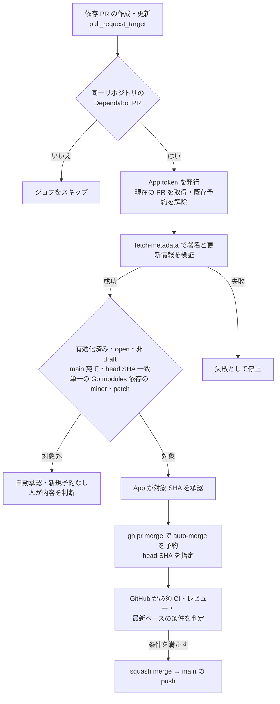
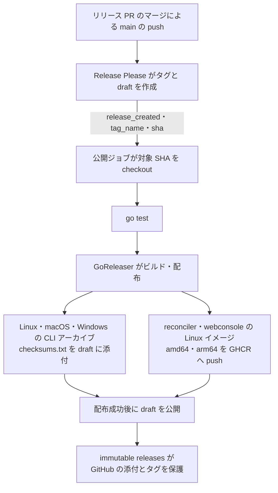

# 依存更新とリリース

AWS Lambda 用の reconciler・webconsole と、利用者向け CLI を配布する。GHCR の 2 イメージは Linux の amd64・arm64 に対応する。CLI は Linux・macOS・Windows の amd64・arm64 向けに配布する。

## フローの関係

依存更新のマージとリリース PR のマージは、別の PR・別の main 更新である。依存 PR は条件を満たすと自動マージし、リリース PR は人がレビューしてマージする。

App token による依存 PR のマージとリリース PR の作成により、通常の push・pull_request を起点に処理をつなぐ。通常の開発 PR のマージも、main の push からリリース候補の判定へ進む。

## CI と配布の確認

単体テスト、floci による統合テスト、Lambda Runtime Interface Emulator を使うイメージテスト、GoReleaser snapshot を必須 ci に集約する。詳細は [配布先と GHCR の設定](ja/development/release.md)を参照する。

## 導入条件

専用 GitHub App、main 限定の automation Environment、必須 ci、レビュー、CODEOWNERS、immutable releases を設定してから導入する。実イベントの受入が済むまで DEPENDABOT_AUTO_MERGE は false とする。

## 依存更新

Dependabot の署名検証済み metadata と YAML の条件を使う。単一のアプリケーション依存の minor・patch だけを自動承認する。複数依存のグループ、major、不明、Actions、Docker は手動レビューとする。

既存予約を解除してから判定し、gh api で対象 SHA を承認する。gh pr merge --auto --squash --match-head-commit で予約し、必須 CI とレビューを GitHub が判定する。github-script は現在の PR を取得する API 呼び出しだけに使う。

自動マージは [dependabot-auto-merge.yml](../.github/workflows/dependabot-auto-merge.yml)で行う。PR の CI は [ci.yml](../.github/workflows/ci.yml)が pull_request で別に実行する。

予約時点で CI が実行中なら、GitHub が条件の成立を待つ。CI の失敗、必要なレビューの不足、draft の状態ではマージしない。取得・承認・予約などの操作が失敗した場合は、その実行を停止して原因を確認する。

## リリース

main の push で Release Please がリリース PR を作成・更新する。人がバージョン、変更履歴、CI を確認してマージする。設定は release-please-config.json と .github/workflows/release-please.yml に置く。

GoReleaser OSS がビルドと配布を同じジョブで行う。GITHUB_TOKEN に公開権限を与えるため、レビュー済み main とビルド依存を信頼する。App の秘密鍵は別ジョブに保つ。配布設定は GoReleaser の設定ファイルに置く。

GitHub の immutable releases で公開後の添付とタグを保護する。Latest は GitHub の標準動作に従う。GHCR latest は自動更新せず、利用者はバージョンまたは digest を指定する。

人がリリース PR をマージした後の処理を示す。[release-please.yml](../.github/workflows/release-please.yml)が main の push で実行する。

GoReleaser の配布先を分岐で示している。両配布先の更新順序は GoReleaser が決める。一方だけ更新された状態で失敗した場合、[再実行の条件](#失敗時の再実行)に従って調査する。

## 失敗時の再実行

配布先への書き込み前なら、失敗したジョブを再実行する。一部配布後は再実行を止め、管理者が draft、添付、GHCR を調査する。原則として修正版を別バージョンで公開する。同名ファイルを上書きしない。

## 停止と再開

有効化変数を false にし、ワークフローを無効化する。実行中・待機中の実行をキャンセルし、終了を確認してから各 PR の auto-merge を解除する。最後に実行と予約を再確認する。公開停止中はリリース PR をマージしない。

管理者による App・保護設定の操作は、[GitHub 設定の管理](https://github.com/moepig/github/blob/automation/dependency-release/docs/management.md)を参照する。
