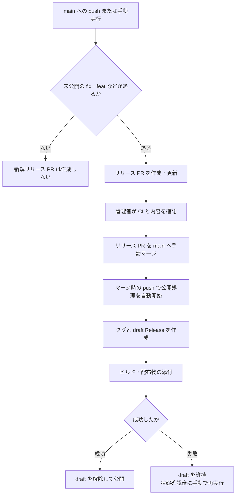

# 依存更新とリリース

依存更新の自動マージと、リリース PR から公開する手順を説明する。Dependabot、release-please、GitHub Actions を使い、認証には GITHUB_TOKEN を使う。

## 公開対象と互換性

CLI の引数と出力、設定ファイル、Lambda の入出力、Web API、保存データ、最低 Go バージョンを互換性の対象とする。CLI の 6 種類のアーカイブと 2 種類のマルチプラットフォームイメージを配布する。AWS へのデプロイは既存の手順で行う。

## 設定

[Dependabot 設定](../.github/dependabot.yml)は更新対象とコミットの prefix、[release-please 設定](../release-please-config.json)と [manifest](../.release-please-manifest.json)は製品バージョンを管理する。必須チェックは GitHub Actions 提供の ci とする。

アプリケーション依存の prefix は fix、Actions 更新は chore にする。依存ごとの配布物への影響を解析しないため、テスト専用依存の更新もリリース候補になり得る。ビルドに影響する Actions 更新をリリースに含める場合は、管理者が PR タイトルを fix で始まる形式に直してからマージする。

## 自動マージ

[Dependabot auto-merge](../.github/workflows/dependabot-auto-merge.yml)は fetch-metadata で署名と更新種別を確認する。minor・patch は bot が承認し、対象 SHA の squash auto-merge を予約する。major、更新種別不明、draft、breaking-change ラベル付きの PR は予約を解除し、管理者が確認して手動でマージする。

導入時は main に ci、最新ベースでの検証、レビュー、push 後の承認無効化を設定する。Actions の PR 作成・承認も許可する。設定と CI の成功を確認してから、リポジトリ変数 DEPENDABOT_AUTO_MERGE を true にする。

## 公開

[Release Please](../.github/workflows/release-please.yml)は main への push と手動実行で起動する。定期実行は行わない。前回リリース以降に fix・feat などの対象変更があれば、リリース PR を作成する。既存 PR があれば更新し、対象変更がなければ新規 PR は作成しない。

GITHUB_TOKEN による依存 PR の自動マージでは push ワークフローが起動しない。自動マージ後に PR を作成・更新するには、Actions の Release Please から Run workflow を選び、main を指定して実行する。このとき tag は空欄にする。tag の指定は既存 draft の再配布に使う。

PR の作成から公開までの流れを、次の図に示す。

リリース PR は管理者が手動でマージする。CI が承認待ちなら開始を承認し、バージョン、変更履歴、CI、互換性を確認する。マージに伴う main への push で Release Please が自動起動し、タグと GitHub Release を作成する。公開を始めるための追加操作は不要である。

タグと draft Release を作成し、[配布処理](../.github/workflows/distribute.yml)を直接呼ぶ。タグと指定 SHA が一致しない場合、または Release が公開済みの場合は停止する。GoReleaser が既存 draft へ配布物を添付し、release-please の変更履歴を維持する。処理の成功後に draft を解除する。

## 失敗時の再実行

タグ、コミット、既存配布物を確認してから失敗ジョブを再実行する。元の実行を使えない場合は、main の Release Please を手動実行し、tag に既存 draft のタグを指定する。tag を指定した実行では PR を作成・更新せず、配布だけを再実行する。

公開済み Release へ再配布しない。未完了の Release を履歴から探す自動復旧は行わない。公開を止める場合は Release Please を無効にし、実行中の処理を確認する。停止中はリリース PR をマージしない。

コンテナは GoReleaser がバージョン付きタグへ配布する。配布後に latest を更新し、プレリリースでは更新しない。draft の再配布では既存イメージを置き換える可能性があるため、レジストリの状態を確認してから再実行する。

セキュリティ修正の根拠登録は行わず、GitHub 標準の通知から公開時期を判断する。自動マージを止める場合は DEPENDABOT_AUTO_MERGE を false にし、予約済み PR の auto-merge も解除する。
