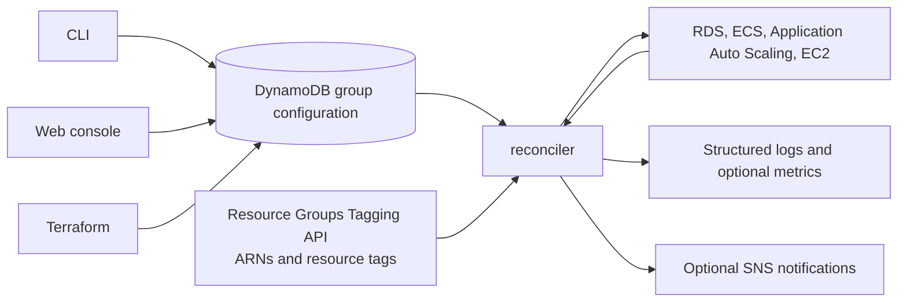

# Architecture

This document explains executable components, configuration inputs and outputs, and Lambda runtime structure.

## Components and data flow

The reconciler, CLI, and web console are separate executables. Their external dependencies and data flow are:

The CLI and web console share configuration validation and conditional writes. Terraform manages DynamoDB items directly. The reconciler reads DynamoDB and observes and modifies AWS resources.

## Persistence and processing boundaries

DynamoDB stores group configuration. Current resource state comes from AWS APIs. Operation history, checkpoints, and ECS startup phases are not persisted.

A cycle reads complete configuration and discovery snapshots before processing individual resources. Global read failures and individual processing failures have separate boundaries. Overlapping invocations are allowed; later cycles converge after older invocations finish.

For read boundaries, error isolation, and test contracts, see [Reconcile implementation contracts](../development/reconcile.md). For AWS API order, see [Resource operation sequences](../development/resource_sequence.md).

## Lambda runtime

The reconciler image is a Lambda handler. Both periodic and manual invocations perform a full reconcile without interpreting the payload. Work is completed within the invocation rather than partitioned across invocations.

The web-console image includes an HTTP server and Lambda Web Adapter. The adapter translates API Gateway or similar invocation events into HTTP. The console application remains a regular HTTP server.

Reserved concurrency of 1 is optional to reduce overlapping execution. Correctness does not depend on excluding concurrent invocations.
