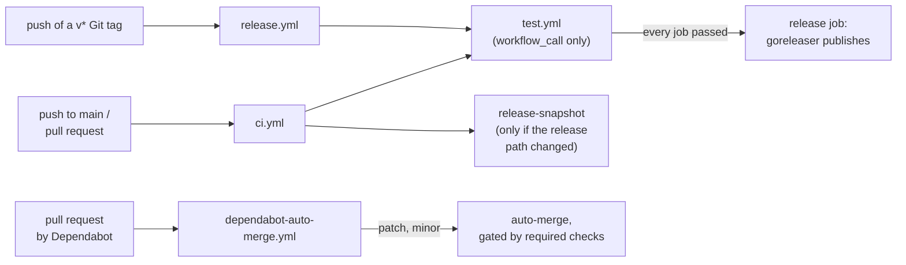

# GitHub Actions

CI, releases, and dependency updates all run on GitHub Actions from the definitions under `.github/`. This document covers each workflow's role, how they call one another, and what changing them brings about.

## Workflows

The definition files under `.github/` and their roles are collected below.

| Path | Trigger | Role |
|---|---|---|
| `workflows/ci.yml` | push to `main`, pull request | Tests and release snapshots |
| `workflows/test.yml` | Called by `ci.yml` and `release.yml` | lint, unit/integration/image tests, `goreleaser check` |
| `workflows/release.yml` | push of a `v*` Git tag | Tests, then publishes the release and images |
| `workflows/dependabot-auto-merge.yml` | pull request | Enables auto-merge for Dependabot patch/minor updates |
| `dependabot.yml` | weekly | Go module, Action, and Docker base-image updates |

Dependency updates are grouped and use a 7-day cooldown after publication.

Every job runs on ubuntu-latest. Jobs that set up Go take its version from go.mod.

Integration and image tests need no AWS credentials. Both the emulator and the Runtime Interface Emulator run on the runner's Docker daemon.

## Composition

CI and releases share `test.yml`, which runs only through `workflow_call`. A release therefore runs the same checks as a pull request against the tagged commit.

The release job declares `needs: test`. If any check fails, no release is created for that tag and nothing is pushed to GHCR.

The following diagram shows calls from triggers through to artifact publication.



## The release snapshot

`--snapshot` cross-compiles every target and assembles both images without pushing them. It tests builds with `build/Dockerfile.*`, which `goreleaser check` cannot verify because it only validates configuration.

Use `--snapshot` rather than `--skip=publish` to build the images. dockers_v2 builds and pushes in one step, so skipping publication also skips the image build.

The snapshot build runs only on pull requests changing .goreleaser.yaml, build/, the root Dockerfile, go.mod, or go.sum. Pushes to main skip the build.

The `release-snapshot` job always runs and reports a result. Filtering it out with `on.paths` would leave a required check without a result, preventing the pull request from merging. The job therefore skips build steps through an internal condition.

`make lint` cross-compiles the CLI for darwin and windows on every pull request. This detects Go changes that compile on linux but fail on the CLI's release platforms. With a populated build cache, this takes seconds.

## Check names

`ci.yml` reaches most of its jobs through a reusable workflow, so those check names carry both levels: `test / lint`, `test / unit`, `test / integration`, `test / image`, and `test / goreleaser`. `release-snapshot` is a job of `ci.yml` itself and appears under that name.

Branch protection selects required checks by these names. Dependabot's auto-merge waits for those checks only when they are required. For the repository settings, see the auto-merge section in [Releases and dependency updates](release.md).

## Token permissions

Every workflow declares default GITHUB_TOKEN permissions with `permissions: contents: read`. Jobs that need write access add permissions at job level.

The release job holds `contents: write` and `packages: write`, and the auto-merge job holds `contents: write` and `pull-requests: write`.

The auto-merge job runs only when the pull request author is dependabot[bot]. It passes GITHUB_TOKEN to fetch-metadata and gh pr merge.

## Pinning actions by SHA

Every action is pinned to a full commit SHA rather than a tag, with the corresponding version left in a trailing comment. The form is as follows.

```yaml
- uses: actions/checkout@3d3c42e5aac5ba805825da76410c181273ba90b1 # v7.0.1
```

A tag is a mutable reference. Anyone with admin rights on an action's repository can repoint `v7` at different code. Workflows using that tag then execute the changed code on the next run without a change in this repository. A commit SHA cannot be repointed.

SHA pinning fixes the code executed by jobs with write access. This includes the release job, which holds `contents: write` and `packages: write`, and the auto-merge job, which enables merging without human review.

Dependabot uses the trailing version comment to identify updates. When a new version appears, it updates both the SHA and the comment.

`uses: ./.github/workflows/test.yml` is excluded from SHA pinning because local reusable workflows resolve against the running commit.

## Changes whose effects go unnoticed

The following table lists effects to check when changing workflows. A successful run does not establish that required-check settings or action references still match the intended configuration.

| Change | Effect |
| --- | --- |
| Change an action SHA to a tag | Executed code can change without a local change |
| Rename a job in `test.yml` | Its name no longer matches required-check settings |
| Add a job to `test.yml` | The same test time is added to releases |
| Remove `cooldown` from `dependabot.yml` | The wait before proposing updates becomes shorter |
| Filter `release-snapshot` with `on.paths` | Nonmatching pull requests receive no result |

Changing a SHA to a tag allows different code to run without a change in this repository. For the reason for pinning, see Pinning actions by SHA.

Renaming a job also requires updating the required-check settings in branch protection. Without a matching name, successful completion of the renamed job is no longer a merge requirement.

Removing cooldown makes newly published versions eligible for updates that can be auto-merged without human review. For the waiting period and auto-merge conditions, see [Releases and dependency updates](release.md).

If a check filtered out by `on.paths` is required, the pull request waits for a result that is never reported. For the job structure that always reports a result, see The release snapshot.

## Files outside `.github/`

The rest of the release path lives outside `.github/`. The `.goreleaser.yaml` at the repository root defines what a release produces, and `build/Dockerfile.reconciler` and `build/Dockerfile.webconsole` assemble the published images.
