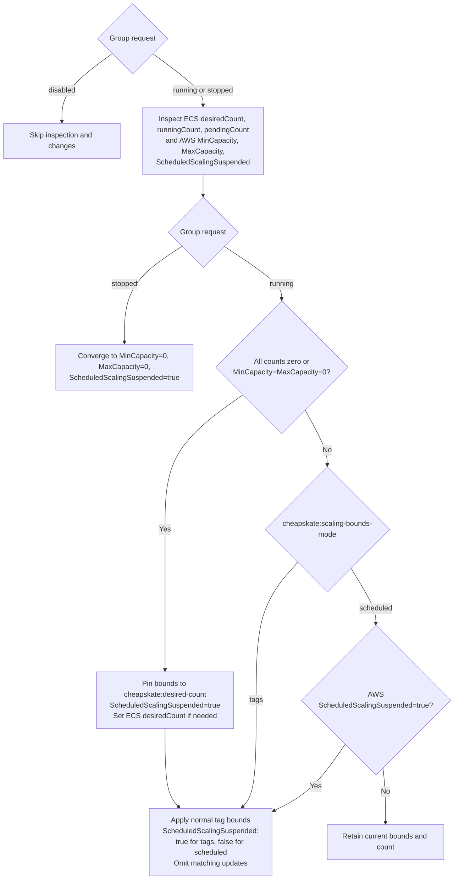

# ECS startup, shutdown, and scaling

This document explains the purpose and behavior of keeping REPLICA ECS services active during required hours and managing their scaling bounds.

## Purpose and scope

cheapskate starts and stops ECS services according to group schedules and overrides. While a service is active, capacity can change with demand instead of remaining fixed at its startup count. AWS Application Auto Scaling Scheduled Scaling can also change bounds by time of day. Group start_cron and stop_cron control operating hours; AWS scheduled actions control scaling bounds.

Set cheapskate:scaling-bounds-mode to choose between continuously maintaining tag bounds and allowing Scheduled Scaling to change them. Scheduled Scaling suspension follows this management mode.

| Mode | Purpose | Bounds during operation | Scheduled Scaling during operation |
| --- | --- | --- | --- |
| tags | Continuously maintain the range defined by tags | Repair differences from cheapskate:scaling-min and cheapskate:scaling-max | Suspended to prevent competing changes to the tag range |
| scheduled | Delegate time-based bounds changes to AWS | Apply tag bounds at the end of startup and when resuming, then retain subsequent changes | Enabled |

Choose tags to maintain tag bounds even on a service without scheduled actions. The default is scheduled. Both modes retain in-range capacity and leave dynamic-scaling suspension flags unchanged. The tags mode does not fix the task count.

Both modes suspend Scheduled Scaling while the service is stopped to prevent scheduled actions from restarting it. The tag retains the intended mode across daily stop/start cycles.

### Operational examples

These examples assume a registered scalable target and a running group request.

| Operation | Configuration | cheapskate behavior |
| --- | --- | --- |
| Keep an API's task count within a range of 1–3 | Set cheapskate:scaling-min=1, cheapskate:scaling-max=3, and cheapskate:scaling-bounds-mode=tags | If the maximum is changed to 6 in AWS, restore it to 3 on the next successful cycle |
| Use a range of 4–6 during the day and 1–2 at night | Register AWS scheduled actions with daytime bounds of 4 and 6 and nighttime bounds of 1 and 2, and set cheapskate:scaling-bounds-mode=scheduled | Retain the bounds changed by AWS instead of restoring normal tag bounds |

To remain at zero outside operating hours, use cheapskate's stop schedule or override=stopped. Bounds mode selects the scaling range during operation.

## Configuration and current state

Group configuration, service tags, and AWS observations have separate purposes:

| Source | Fields | Purpose |
| --- | --- | --- |
| DynamoDB | start_cron, stop_cron, override, override_expires_at | Select running, stopped, or disabled using current time and DEFAULT_TIMEZONE |
| DynamoDB | ecs_max_count | Validate startup count and normal maximum applied by cheapskate |
| ECS service tags | cheapskate:group | Name of the DynamoDB group |
| ECS service tags | cheapskate:desired-count | Startup count from all-zero counts or 0/0 bounds |
| ECS service tags | cheapskate:scaling-min, cheapskate:scaling-max | Normal bounds applied at the end of startup, during tags-mode operation, and when resuming |
| ECS service tags | cheapskate:scaling-bounds-mode | Whether tags or scheduled manages bounds during operation |
| Current ECS state | desiredCount, runningCount, pendingCount | Configured, running, and pending task counts |
| Current Application Auto Scaling state | MinCapacity, MaxCapacity, ScheduledScalingSuspended | Applied bounds and suspension flag |

The group's running request means keeping the service active. It is distinct from current ECS desiredCount and the startup-count tag. The cheapskate:desired-count tag does not continuously fix running capacity.

For DynamoDB attributes, CLI operations, and tag types and defaults, see [ECS service configuration](resources/ecs-service.md).

### Bounds mode and the AWS suspension flag

cheapskate:scaling-bounds-mode is the bounds management method that the user specifies as an ECS service tag. cheapskate does not add or rewrite this tag.

ScheduledScalingSuspended is a suspension flag on the AWS Application Auto Scaling scalable target. A value of true suspends Scheduled Scaling; false enables it. cheapskate controls this AWS flag according to the group request and bounds mode.

For a registered scalable target, the mapping is:

| Situation | Bounds mode | Value applied to ScheduledScalingSuspended |
| --- | --- | --- |
| Running, after startup configuration completes | tags | true |
| Running, after startup configuration completes | scheduled | false |
| Applying a stop request | Either mode | true |
| Initializing startup capacity | Either mode | true |

The tag can therefore remain scheduled while AWS ScheduledScalingSuspended is true during shutdown or startup initialization. The final startup update applies the value corresponding to bounds mode. A disabled group request leaves the AWS flag unchanged.

## Stopping and starting

ECS is stopped only when desiredCount, runningCount, and pendingCount are all zero. Updating desiredCount and starting or stopping tasks are asynchronous; runningCount changes later. pendingCount counts tasks waiting to start, not tasks waiting to terminate.

### With a scalable target

A stopped group request applies MinCapacity=0, MaxCapacity=0, and ScheduledScalingSuspended=true regardless of bounds mode.

A running group request initializes capacity only when all ECS counts are zero or both bounds are zero. It first pins bounds to cheapskate:desired-count and suspends Scheduled Scaling to prevent bounds changes during initialization. It reads ECS capacity again and changes desiredCount only if necessary. The final update applies normal bounds and the suspension state corresponding to the bounds mode together.

Completed startup configuration does not mean all tasks have started. Updates whose settings already match are omitted.

### Without a scalable target

Stopping sets desiredCount=0. Starting sets cheapskate:desired-count only when all counts are zero. An active service, including one with pending tasks, is not reset to startup capacity. A scalable target is not created, so bounds mode does not change AWS scaling settings.

## Scaling during normal operation

When a scalable target exists and capacity initialization is unnecessary, these rules apply:

| Bounds mode | Current AWS state | Behavior |
| --- | --- | --- |
| tags | Normal bounds or suspension differ | Apply normal bounds and ScheduledScalingSuspended=true |
| tags | Settings match | No changes |
| scheduled | ScheduledScalingSuspended=true | Apply normal bounds and ScheduledScalingSuspended=false |
| scheduled | ScheduledScalingSuspended=false | Retain current bounds and count |

Changing modes or resuming retains desiredCount when it is within normal bounds. AWS adjusts capacity outside that range. The startup-count tag is not reapplied. For capacity adjustments, see [RegisterScalableTarget](https://docs.aws.amazon.com/autoscaling/application/APIReference/API_RegisterScalableTarget.html).

### Suspension scope

cheapskate does not rewrite the bounds-mode tag. To resume Scheduled Scaling, select scheduled and set the group's request to running.

Suspension prevents new scheduled actions from starting. It does not cancel an action already underway or replay actions whose execution times passed during suspension. Resuming enables future executions. See [AWS scaling suspension and resumption](https://docs.aws.amazon.com/autoscaling/application/userguide/application-auto-scaling-suspend-resume-scaling.html).

Scheduled action definitions, DynamicScalingInSuspended, and DynamicScalingOutSuspended are unchanged. For flag scope, see [SuspendedState](https://docs.aws.amazon.com/autoscaling/application/APIReference/API_SuspendedState.html).

### Capacity limits and remaining at zero

ecs_max_count validates the startup-count and normal-maximum tags applied by cheapskate. It is not an absolute limit on Scheduled Scaling bounds or current capacity.

If Scheduled Scaling reduces all counts to zero while the group requests running, the next cycle starts the service again. Use cheapskate's stop schedule or a stopped override for periods that must remain at zero.

## Request and current-state flow

For a registered scalable target, operations are selected as follows. Update values come from tags; stopped and suspended status come from current AWS state.

## Tag changes and partial failures

A failed operation leaves applied AWS settings in place. The next cycle reads group configuration, tags, and current state again. Neither DynamoDB nor tags store execution history or startup progress.

A positive fixed range can represent either normal configuration or partial startup. It is not used to infer an execution phase. Normal settings follow bounds mode and current AWS state. Tag changes during partial startup retain applied capacity within the new normal bounds. A changed cheapskate:desired-count takes effect at the next start from all-zero counts or 0/0 bounds.

A later cycle that reads stopped or disabled follows that request instead of resuming old startup work. For overlapping invocation behavior, see [Start and stop behavior](resource_flow.md#failures-and-overlapping-invocations).

## Configuration and current-state examples

These examples use cluster dev, service api, and an existing scalable target. DynamoDB ecs_max_count is a Number; other attributes and all tags are Strings. No override_expires_at is registered, so the override is indefinite. The common DynamoDB item is:

| DynamoDB attribute | Registered value |
| --- | --- |
| pk | CONFIG |
| sk | GROUP#dev |
| override | running |
| ecs_max_count | 3 |

Unless a change is shown explicitly, the service tags are:

| ECS service tag | Registered value |
| --- | --- |
| cheapskate:group | dev |
| cheapskate:desired-count | 2 |
| cheapskate:scaling-min | 1 |
| cheapskate:scaling-max | 3 |
| cheapskate:scaling-bounds-mode | scheduled |

The tables show possible AWS observations. Updating configuration does not require runningCount to match immediately.

### Starting from zero with an intermediate failure

DynamoDB override=running selects startup. All counts and bounds are zero, so capacity is pinned to 2 and Scheduled Scaling stays suspended. Inspection fails before normal bounds are applied. A possible progression is:

| Point | desiredCount | runningCount | pendingCount | MinCapacity | MaxCapacity | ScheduledScalingSuspended | Actual ECS situation |
| --- | --- | --- | --- | --- | --- | --- | --- |
| Before startup | 0 | 0 | 0 | 0 | 0 | true | No tasks; stop settings remain |
| Failure after pinning | 2 | 0 | 2 | 2 | 2 | true | Two tasks pending; none running |
| Normal settings applied next cycle | 2 | 1 | 1 | 1 | 3 | false | One task running; one pending |
| Tasks started | 2 | 2 | 0 | 1 | 3 | false | Two tasks running |

The next cycle sees positive desiredCount and nonzero bounds. It applies normal bounds 1..3 and resumes without repinning startup capacity. It does not wait for every task to start.

### Changing tags on a running fixed range

DynamoDB keeps override=running and ecs_max_count=3. Membership stays cheapskate:group=dev. Change the other tags as follows:

| ECS service tag | Before | After |
| --- | --- | --- |
| cheapskate:desired-count | 2 | 1 |
| cheapskate:scaling-min | 2 | 1 |
| cheapskate:scaling-max | 2 | 3 |
| cheapskate:scaling-bounds-mode | tags | tags |

Applying normal bounds while retaining in-range capacity produces these observations:

| Point | desiredCount | runningCount | pendingCount | MinCapacity | MaxCapacity | ScheduledScalingSuspended | Actual ECS situation |
| --- | --- | --- | --- | --- | --- | --- | --- |
| Tags changed, settings not yet applied | 2 | 2 | 0 | 2 | 2 | true | Two tasks running in a fixed range |
| Normal bounds applied | 2 | 2 | 0 | 1 | 3 | true | Both running tasks retained |

Neither all-zero counts nor 0/0 bounds apply, so the new startup count of 1 is not used. Current desiredCount=2 is within the new range. The same AWS state left by a partial startup produces the same behavior.

### Resuming with capacity outside normal bounds

DynamoDB keeps override=running and ecs_max_count=3. Tags use the common values, including cheapskate:scaling-bounds-mode=scheduled. AWS has old bounds 4..6, suspension enabled, and five running tasks. Applying normal bounds and resuming can produce:

| Point | desiredCount | runningCount | pendingCount | MinCapacity | MaxCapacity | ScheduledScalingSuspended | Actual ECS situation |
| --- | --- | --- | --- | --- | --- | --- | --- |
| Before resuming | 5 | 5 | 0 | 4 | 6 | true | Five tasks running |
| Normal bounds and resume applied | 3 | 5 | 0 | 1 | 3 | false | Configured count is three; excess tasks still draining |
| Tasks stopped | 3 | 3 | 0 | 1 | 3 | false | Three tasks running |

AWS adjusts desiredCount to 3 within normal bounds 1..3. It is not reset to the startup-count tag of 2.

### Scheduled Scaling after a lost final response

DynamoDB and tags use the common values. Applying normal bounds 1..3 and ScheduledScalingSuspended=false succeeds, but its response is lost. A scheduled action then changes bounds to 4..6. Possible observations are:

| Point | desiredCount | runningCount | pendingCount | MinCapacity | MaxCapacity | ScheduledScalingSuspended | Actual ECS situation |
| --- | --- | --- | --- | --- | --- | --- | --- |
| Final update succeeds; response lost | 2 | 2 | 0 | 1 | 3 | false | Two running tasks; Scheduled Scaling enabled |
| Scheduled action changes bounds | 4 | 2 | 2 | 4 | 6 | false | Configured count rises to four; two tasks pending |
| Next cycle | 4 | 4 | 0 | 4 | 6 | false | Four tasks running |

Bounds mode is scheduled and the AWS suspension flag is false, so the next cycle leaves bounds and capacity unchanged. DynamoDB ecs_max_count=3 validates cheapskate's tag-driven changes; it does not cap scheduled action bounds or current capacity.

### Stopping during startup

Change DynamoDB override from running to stopped. Leave ecs_max_count=3 and all service tags unchanged. Applying bounds 0/0 and suspension can produce:

| Point | desiredCount | runningCount | pendingCount | MinCapacity | MaxCapacity | ScheduledScalingSuspended | Actual ECS situation |
| --- | --- | --- | --- | --- | --- | --- | --- |
| Before stop settings | 2 | 1 | 1 | 2 | 2 | true | One task running; one pending |
| Stop settings applied | 0 | 1 | 0 | 0 | 0 | true | Pending task cancelled; running task draining |
| Tasks stopped | 0 | 0 | 0 | 0 | 0 | true | No running or pending tasks; stop settings satisfied |

The stop request takes precedence over the startup-count tag of 2 and scheduled bounds mode. Normal startup settings are not restored. Changing DynamoDB override to disabled instead skips AWS inspection and changes, retaining the settings present at that point.
