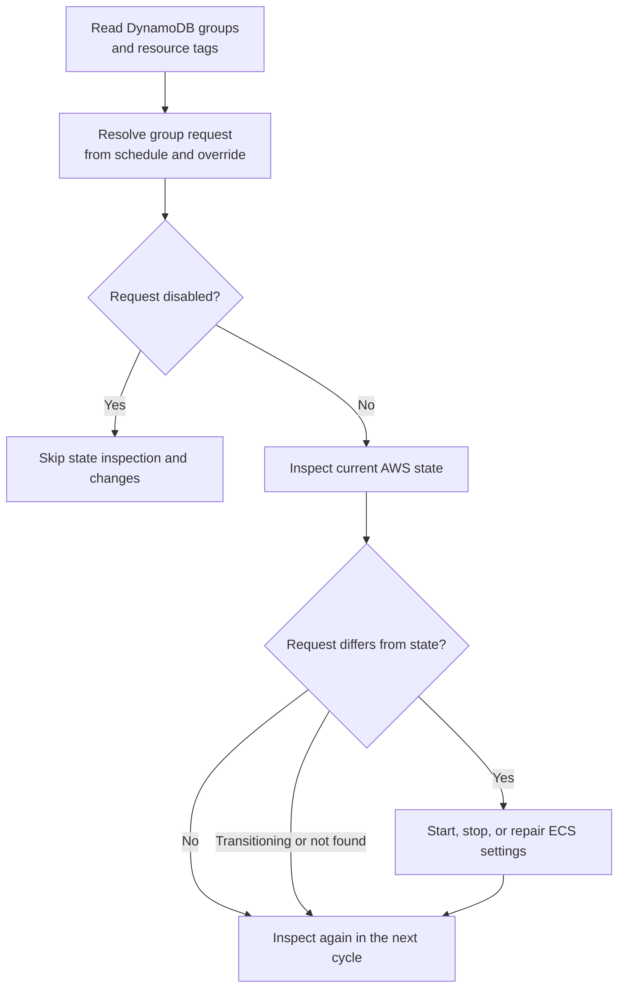

# Start and stop behavior

This document explains when configuration takes effect, how periodic state inspection works, and what starting or stopping means for each supported resource type.

## When configuration takes effect

The reconciler normally reads all groups and tagged resources every five minutes. A configuration change takes effect in a successful cycle that reads it. A successful configuration command does not immediately change AWS resources.

Each cycle compares the requested state with current AWS state. After initiating an operation, it finishes without waiting for the transition to complete. Later cycles inspect the result. The common flow is:

RDS and EC2 operations wait for a later cycle while a resource is transitioning. ECS stop requests and scaling configuration can be applied while tasks are starting or draining.

## Supported resources and operations

Eligibility and operation effects are:

| Resource | Eligibility | Start | Stop |
| --- | --- | --- | --- |
| RDS DB instance | Not a cluster member; not RDS Custom | Start the instance | Stop the instance |
| Aurora DB cluster | Engine starts with aurora | Start the cluster | Stop the cluster |
| EC2 instance | Not a member of an Auto Scaling group | Start the instance | Stop the instance |
| ECS service | REPLICA; long ARN | Apply startup count and scaling settings | Set desiredCount and registered bounds to zero; suspend Scheduled Scaling |

RDS DB instances and Aurora clusters are running when available and stopped when stopped. Other states wait for a later cycle. Do not register Aurora's member DB instances as individual stop targets.

EC2 running and stopped map to their corresponding states. A terminated instance is treated as not found and is not restarted.

For ECS task counts, normal bounds, and suspension behavior, see [ECS startup, shutdown, and scaling](ecs.md).

## Manual changes and pausing management

Manually starting or stopping a managed resource causes a later cycle to restore the group's request. Set a disabled override first when manual changes must remain in place.

Stopping cheapskate itself, setting disabled, removing membership tags, and deleting a group leave existing AWS settings in place. They do not restore ECS bounds or suspension flags. To end management, see [Daily operations](operations.md#ending-management).

## Failures and overlapping invocations

A cycle that fails to read all groups or discover resources does not inspect or change resources. Group configuration errors and individual resource failures do not stop other resources. Later cycles read configuration and current state again before choosing an operation.

Retries and overlapping invocations can repeat an operation. An invocation holding older configuration may temporarily apply an older request after a change. Once older invocations finish, configuration is stable, and AWS APIs succeed, later cycles converge to the latest request. Persistent failures have no bounded convergence time.

A successful operation means AWS accepted the request, not that the resource completed its transition. For observing results, see [Logs, metrics, and notifications](monitoring.md).
