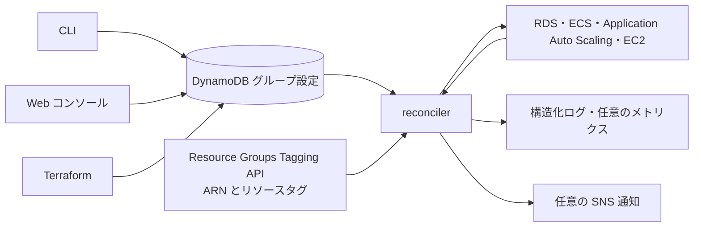

# アーキテクチャ

本ドキュメントは、cheapskate の実行コンポーネント、設定の入出力、および Lambda 上の実行構成を説明する。

## コンポーネントとデータの流れ

reconciler、CLI、および Web コンソールは独立した実行ファイルである。コンポーネントと外部サービスの関係を、次の図に示す。

CLI と Web コンソールは、共通の設定変更処理で検証と条件付き書き込みを行う。Terraform は DynamoDB アイテムを直接管理する。reconciler は DynamoDB を読み取り、AWS リソースを観測・変更する。

## 永続化と処理境界

DynamoDB に保存するのはグループ設定である。リソースの現在状態は AWS API から取得し、操作履歴、checkpoint、および ECS 起動フェーズは保存しない。

1 サイクルは設定と検出リソースの snapshot を読み終えてから、個別リソースの処理を始める。全体読み込みの失敗と個別処理の失敗は別の境界で扱う。同時実行を許容し、古い実行の終了後に後続サイクルが設定へ収束させる。

読み込み境界、エラー分離、およびテストの契約は、[Reconcile の実装契約](../development/reconcile.md)を参照。AWS API の呼び出し順は、[リソース操作のシーケンス](../development/resource_sequence.md)を参照。

## Lambda 実行

reconciler イメージは Lambda handler として動作し、定期・手動のどちらの呼び出しも全体の reconcile を行う。payload の内容は解釈しない。1 invocation 内で対象を分割せず、処理を完了させる。

Web コンソールのイメージは HTTP server と Lambda Web Adapter を含む。アダプタが API Gateway などの呼び出しを HTTP へ変換する。Web コンソール本体は通常の HTTP server として動作する。

reconciler 用 Lambda の reserved concurrency=1 は、重複実行を抑える任意の設定である。正しさは同時実行の排除に依存しない。
