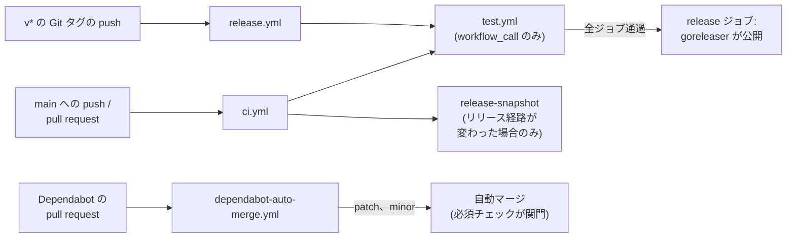

# GitHub Actions

CI、リリース、依存の更新は、いずれも `.github/` 配下の定義により GitHub Actions 上で実行される。本ドキュメントは、各ワークフローの役割、相互の呼び出し関係、および変更時に生じる影響を記述する。

## ワークフロー

`.github/` に置く定義ファイルと、その役割を、以下にまとめる。

| パス | トリガ | 役割 |
|---|---|---|
| `workflows/ci.yml` | `main` への push、pull request | 検査とリリース経路のスナップショット |
| `workflows/test.yml` | `ci.yml`、`release.yml` からの呼び出し | lint、単体・結合・イメージテスト、`goreleaser check` |
| `workflows/release.yml` | `v*` の Git タグの push | 検査後に GitHub リリースとイメージを公開 |
| `workflows/dependabot-auto-merge.yml` | pull request | Dependabot の patch/minor 更新に自動マージを設定 |
| `dependabot.yml` | 週次 | Go モジュール、Actions、Docker ベースイメージの更新 |

依存の更新はグループ化し、公開から 7 日の cooldown を設定する。

各ジョブは ubuntu-latest 上で動作し、Go をセットアップする場合は go.mod のバージョンを使用する。

結合テストとイメージテストは AWS の認証情報を必要としない。エミュレータと Runtime Interface Emulator は、ランナーの Docker デーモンで動作する。

## 構成

CI とリリースは `test.yml` を共有する。`test.yml` は `workflow_call` による呼び出しでのみ実行するため、リリース時にも pull request と同じ検査をタグ付けされたコミットに対して実行する。

リリースジョブは `needs: test` を宣言する。検査が 1 つでも失敗した場合、そのタグにリリースは作られず、GHCR への push も行われない。

トリガから成果物の公開までの呼び出し関係を、次の図に示す。



## リリースのスナップショット

スナップショットは全ターゲットをクロスコンパイルし、両方のイメージを組み立て、push は行わない。`goreleaser check` は設定検証だけでビルドを行わないため、スナップショットで `build/Dockerfile.*` のビルドを検証する。

イメージをビルドするには、`--skip=publish` ではなく `--snapshot` を使用する必要がある。dockers_v2 はビルドと push が一体であり、publish を省略するとイメージのビルドも省略するためである。

スナップショットのビルド対象は、.goreleaser.yaml、build/、ルートの Dockerfile、go.mod、go.sum のいずれかを変更する pull request に限る。main への push ではビルドを省略する。

`release-snapshot` ジョブ自体は常に実行し、結果を報告する。`on.paths` で除外すると、必須チェックの結果が報告されず、pull request はマージに必要な結果を待ち続ける。このため、ジョブ内の条件分岐でビルドのステップだけを省略する。

`make lint` は、pull request ごとに CLI の darwin 向けと windows 向けのクロスコンパイルを実行する。linux ではコンパイルできても CLI のリリース対象プラットフォームで失敗する変更を検出するためである。ビルドキャッシュを使用できる場合は数秒で完了する。

## チェック名

`ci.yml` は大半のジョブに再利用可能ワークフロー経由で到達するため、それらのチェック名は両方の階層を含む形になる。すなわち `test / lint`、`test / unit`、`test / integration`、`test / image`、`test / goreleaser` である。`release-snapshot` は `ci.yml` 自身のジョブであり、その名前のまま現れる。

ブランチ保護はこれらの名前で必須チェックを選ぶ。Dependabot の自動マージが検査の成功を待つためにも、これらを必須チェックに指定する必要がある。自動マージに必要な設定は[リリースと依存の更新](release.md)の自動マージを参照する。

## トークンの権限

GITHUB_TOKEN の既定の権限は、各ワークフローの先頭で `permissions: contents: read` として宣言する。書き込みが必要なジョブだけ、ジョブ単位の permissions で権限を追加する。

リリースジョブは `contents: write` と `packages: write`、自動マージジョブは `contents: write` と `pull-requests: write` を持つ。

自動マージジョブは pull request の作成者が dependabot[bot] の場合だけ実行する。fetch-metadata と gh pr merge には GITHUB_TOKEN を渡す。

## action の SHA 固定

action はすべてタグではなく完全なコミット SHA で固定する。対応するバージョンは行末のコメントに残す。記述の形式は次のとおりである。

```yaml
- uses: actions/checkout@3d3c42e5aac5ba805825da76410c181273ba90b1 # v7.0.1
```

タグは参照先を変更できるため、action のリポジトリの管理権限を持つ者は `v7` を別のコードへ差し替えられる。参照するワークフローは、このリポジトリの変更なしに次回実行から差し替え後のコードを実行する。コミット SHA の参照先は変更できない。

SHA 固定は書き込み権限を持つジョブが実行するコードを固定する。対象には、`contents: write` と `packages: write` を持つリリースジョブと、人を介さずマージを設定する自動マージジョブが含まれる。

行末のバージョンコメントは、Dependabot が更新対象を判定するために使用する。新しいバージョンが出ると、Dependabot が SHA とコメントを更新する。

`uses: ./.github/workflows/test.yml` は SHA 固定の対象外である。ローカルの再利用可能ワークフローは実行中のコミットで解決されるためである。

## 検知されにくい変更の影響

ワークフローの変更時に確認すべき影響を、以下にまとめる。実行結果が成功であっても、必須チェックや参照先の設定が意図どおりとは限らない。

| 変更 | 生じること |
| --- | --- |
| action の参照を SHA からタグに戻す | 実行コードの参照先が可変になる |
| `test.yml` のジョブ名を変える | ブランチ保護の必須チェック名と一致しなくなる |
| `test.yml` にジョブを足す | リリースにも同じ検査時間が加わる |
| `dependabot.yml` から `cooldown` を外す | 公開から更新提案までの待機期間が短くなる |
| `release-snapshot` を `on.paths` で絞る | 条件外の pull request に結果が報告されなくなる |

SHA からタグに戻すと、このリポジトリを変更せずに実行コードを差し替えられる。SHA 固定の理由は action の SHA 固定を参照する。

ジョブ名を変更した場合は、ブランチ保護の必須チェック名も対応させる必要がある。名前が一致しなければ、変更したジョブの成功はマージの条件にならない。

cooldown を削除すると、公開直後のバージョンが更新対象となり、人によるレビューを経ずに自動マージされる場合がある。更新提案までの日数と自動マージの条件は、[リリースと依存の更新](release.md)を参照する。

`on.paths` で除外したチェックを必須にしている場合、pull request は報告されない結果を待ち続ける。結果を常に報告する構成は、リリースのスナップショットを参照する。

## `.github/` の外にあるファイル

リリース経路の残りは `.github/` の外にある。リポジトリルートの `.goreleaser.yaml` がリリースの生成物を定義する。`build/Dockerfile.reconciler` と `build/Dockerfile.webconsole` は公開されるイメージを組み立てる。
