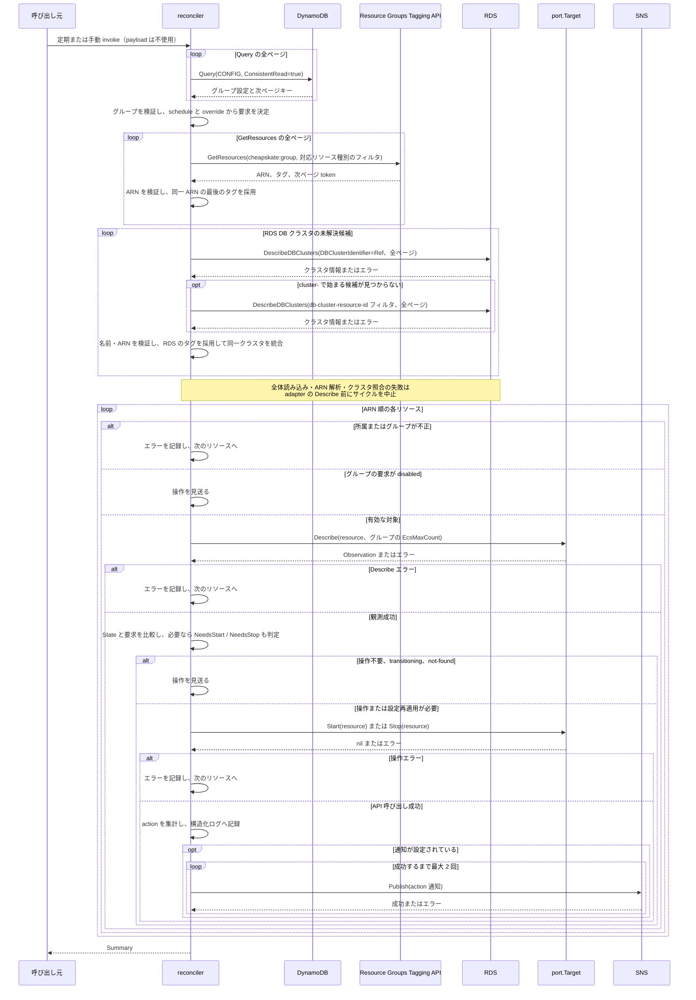
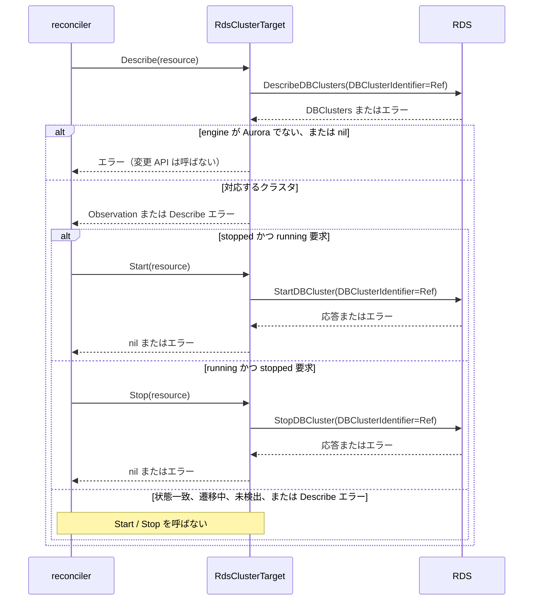
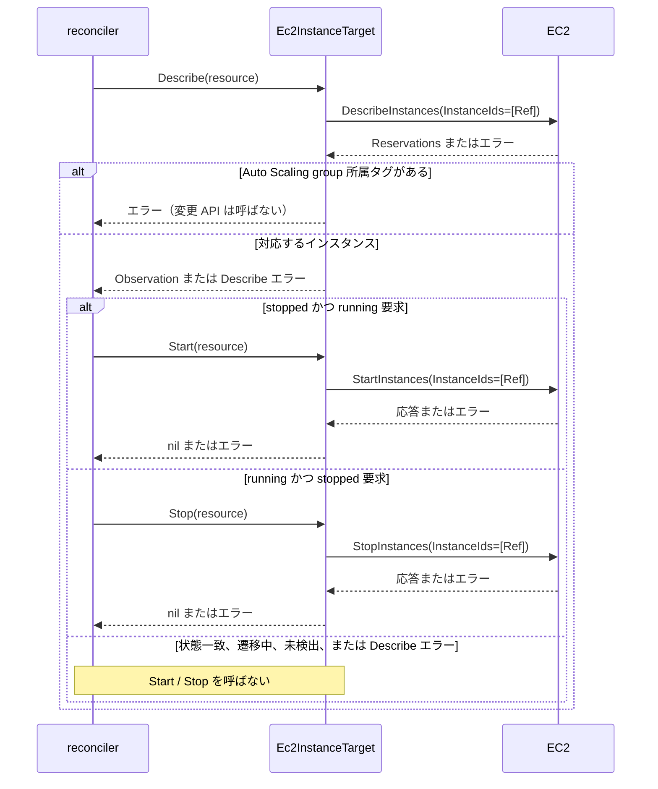
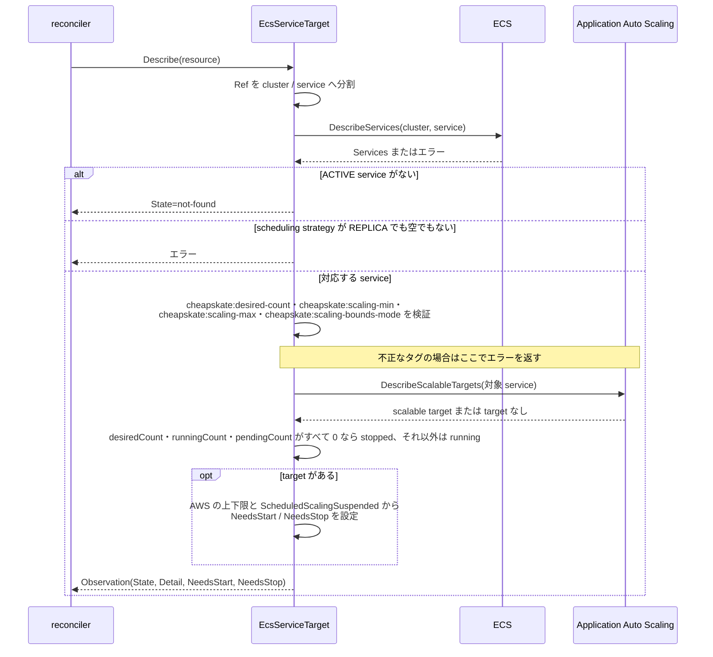
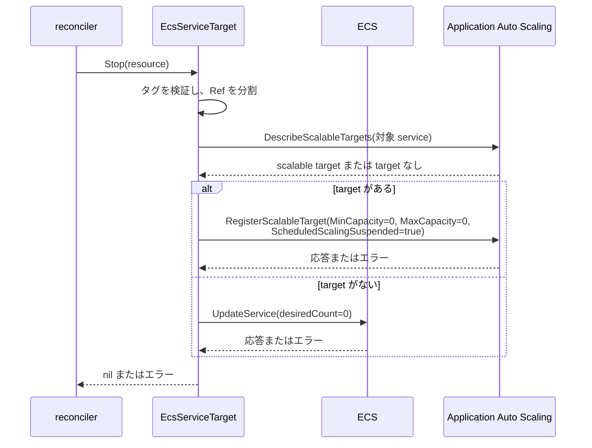
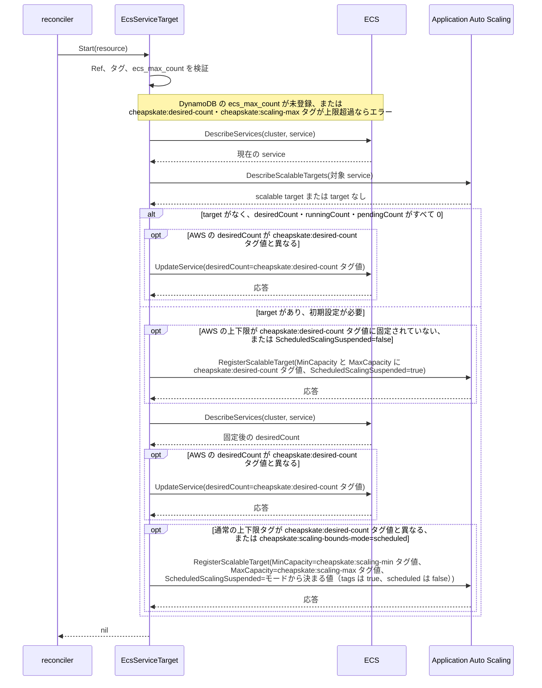
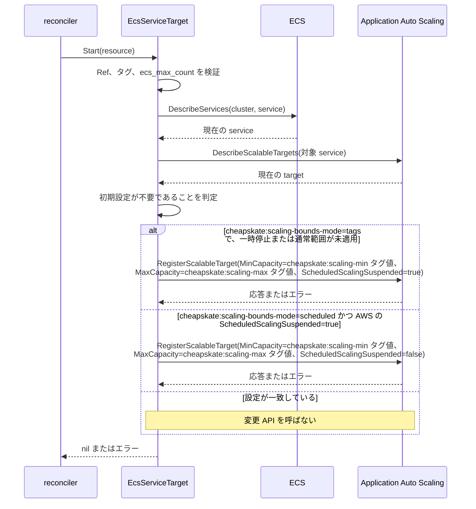
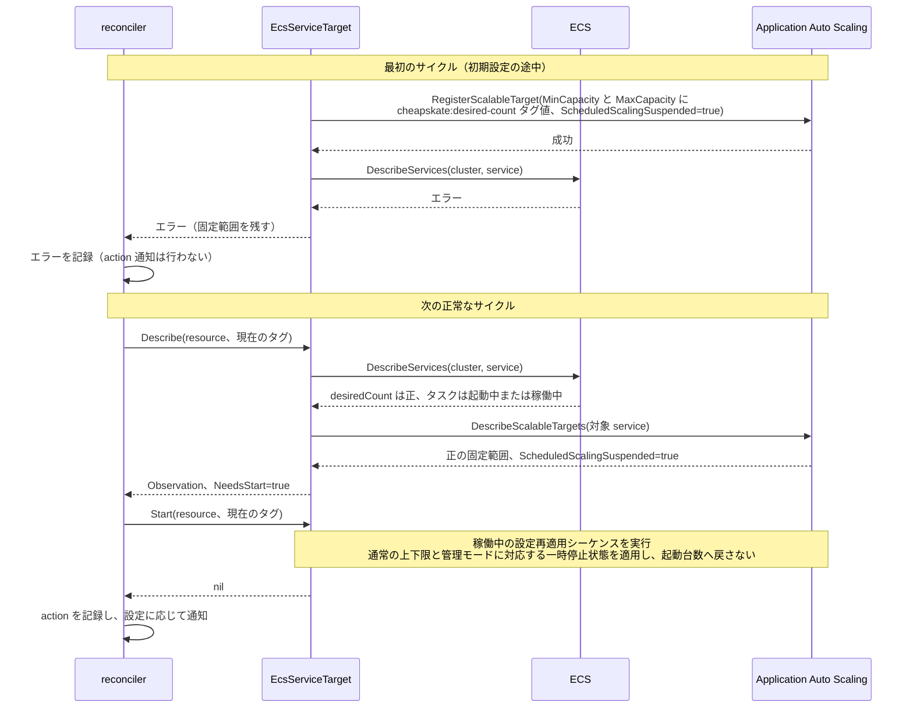

# リソース操作のシーケンス

本ドキュメントは、reconciler と各リソース adapter の呼び出し順、AWS API の分岐、および再適用の条件を示す。コードの読解に必要な入力値と観測結果を記載する。図では AWS SDK 内部の retry を省略する。

## 共通の reconcile サイクル

1 サイクルは全グループと探索結果を取得した後、リソースを ARN 順に処理する。グループの要求が disabled の場合、adapter の Describe も呼ばない。設定読み込みから操作結果の処理までのシーケンスを、次の図に示す。

通知失敗はログへ記録し、API 操作の成功を取り消さない。

Start または Stop の成功は、リソースの遷移完了を意味しない。後続サイクルで再観測する。

DynamoDB への履歴、checkpoint、および AWS 設定の保存は行わない。

サイクル全体の失敗境界と同時実行の扱いは、[Reconcile の実装契約](reconcile.md)を参照する。実装は[reconciler](../../../internal/app/reconcile/reconcile.go)と[リソース探索](../../../internal/aws/tagging/tagging.go)を参照する。

## RDS DB インスタンス

DBClusterIdentifier が非空、または engine が custom- で始まるインスタンスを拒否する。Describe から変更 API までのシーケンスを、次の図に示す。

DBInstanceStatus の available を running、stopped を stopped、その他を transitioning へ対応づける。DBInstanceNotFoundFault、空の応答、または状態を取得できるインスタンスがない場合は not-found とする。DBInstanceStatus が nil の要素は状態判定に使用しない。

実装は[RDS adapter](../../../internal/aws/compute/rds.go)を参照する。

## Aurora DB クラスタ

engine が aurora で始まるクラスタだけを扱う。クラスタのシーケンスを、次の図に示す。

Status の available を running、stopped を stopped、その他を transitioning へ対応づける。DBClusterNotFoundFault、空の応答、または状態を取得できるクラスタがない場合は not-found とする。Status が nil の要素は状態判定に使用しない。

クラスタ member の DB インスタンスへの変更 API は呼ばない。

実装は[RDS adapter](../../../internal/aws/compute/rds.go)を参照する。

## EC2 インスタンス

DescribeInstances のタグに aws:autoscaling:groupName がある場合、インスタンスを拒否する。インスタンスのシーケンスを、次の図に示す。

State.Name の running と stopped を同名の観測状態へ対応づける。terminated と InvalidInstanceID.NotFound は not-found、それ以外の状態は transitioning とする。空の応答、または State が nil のインスタンスしかない場合は not-found とする。

実装は[EC2 adapter](../../../internal/aws/compute/ec2.go)を参照する。

## ECS service

上下限管理モードはタグ範囲の維持と Scheduled Scaling による変更を切り替える。これにより、両者の更新が競合することを防ぐ。tags ではタグ範囲と一時停止を維持し、scheduled では起動設定後に Scheduled Scaling を再開する。

ECS は現在のタスク数に加えて scalable target の設定を取得する。AWS の ScheduledScalingSuspended が未取得または nil の場合は false として扱う。

設定タグは探索時の snapshot を使用し、Start と Stop でも検証する。図中のタグ値には既定値を適用する。

実行状態を保存しない収束設計と具体的な設定値による観測例は、[ECS の起動・停止とスケーリング](../usage/ecs.md)を参照する。

scalable target の識別には、次の 3 項目を使用する。

- ServiceNamespace=ecs
- ResourceId=service/{cluster}/{service}
- ScalableDimension=ecs:service:DesiredCount

RegisterScalableTarget の SuspendedState には ScheduledScalingSuspended だけを指定する。DynamicScalingInSuspended と DynamicScalingOutSuspended は省略する。scheduled action の定義は読み書きしない。

### 状態観測

タスク状態と設定の再適用要求を返すシーケンスを、次の図に示す。

Ref の分割または DescribeServices が失敗した場合もエラーを返す。

Detail にはタスク数を含め、target がある場合は上下限と実際の ScheduledScalingSuspended も含める。target がない場合、NeedsStart と NeedsStop は設定しない。

再適用判定を、以下に示す。両方のフラグが true になる場合も、reconciler はグループの要求に対応する判定だけを使用する。

| 判定 | 条件 |
| --- | --- |
| NeedsStop | AWS の上下限が 0/0 でない、または ScheduledScalingSuspended=false |
| NeedsStart | desiredCount・runningCount・pendingCount がすべて 0、または上下限が 0/0 |
| NeedsStart | AWS の ScheduledScalingSuspended と上下限管理モードが要求する一時停止状態が異なる |
| NeedsStart | tags モードで、AWS の上下限が通常の上下限タグと異なる |

通常の上下限タグは cheapskate:scaling-min と cheapskate:scaling-max である。タグ値との差は、cheapskate:scaling-bounds-mode=tags の場合に判定する。

正の固定範囲から起動途中かどうかを推測しない。cheapskate:scaling-bounds-mode=scheduled の通常稼働中は、Scheduled Scaling による上下限変更を再適用の理由にしない。

### 停止

Stop はタグを検証して target を再取得する。停止シーケンスを、次の図に示す。

上下限管理モードによらず AWS の ScheduledScalingSuspended=true を適用し、タグ自体は変更しない。

ecs_max_count による停止の拒否は行わない。target がある場合は UpdateService と rollback を追加しない。

### 起動の初期設定

Start は、Ref、タグ、および ecs_max_count を検証した後、service と target を再取得する。desiredCount・runningCount・pendingCount がすべて 0、または上下限 0/0 から初期設定を行うシーケンスを、次の図に示す。

この図は成功経路を示す。各 API が失敗した時点で後続の呼び出しを中止してエラーを返す。service が見つからない場合や REPLICA 以外の場合もエラーとなる。

固定後の再観測は RegisterScalableTarget による capacity の調整を確認するために行う。この API は、capacity が上下限の範囲外にあれば、範囲内へ調整する。

cheapskate:scaling-bounds-mode=scheduled による一時停止の解除は、最後の RegisterScalableTarget だけで行う。

上下限管理モードが tags で、通常の上下限タグがともに起動台数タグと同じ場合は、最後の RegisterScalableTarget を省略する。最初の固定で通常設定も成立するためである。

稼働中で初期設定が不要な場合は、次の設定再適用シーケンスを使用する。

### 稼働中の設定再適用

起動の初期設定が不要な service への Start は、通常の上下限と管理モードに対応する一時停止状態を適用する。target がない場合は変更 API を呼ばない。target がある場合のシーケンスを、次の図に示す。

UpdateService は呼ばず、起動台数へ戻さない。

RegisterScalableTarget で適用する通常範囲の外に現在の capacity がある場合は、AWS が範囲内へ調整する。

すべてのタスク数が 0、または上下限が 0/0 の場合は、初期設定を行う。

### 部分失敗と後続サイクル

次の図は、通常のタグ範囲と異なる起動台数への固定後、ECS の状態取得に失敗した場合を示す。次のサイクルでは正の desiredCount を取得している。

実行フェーズは保存せず、次のサイクルの設定と観測値で処理を決める。主な失敗と再適用の関係を、以下に示す。

| 残った状態 | 後続サイクル |
| --- | --- |
| 停止設定が未適用 | AWS の上下限または ScheduledScalingSuspended の差から停止を再適用する |
| すべてのタスク数が 0、または上下限が 0/0 | 起動の初期設定を行う |
| 正の desiredCount と一時停止中の正の固定範囲 | 通常の上下限と管理モードに対応する一時停止状態を適用する。設定台数がその範囲内なら維持する |
| 通常上下限タグが起動台数と等しく、一時停止フラグだけが不一致 | 通常の上下限と管理モードに対応する一時停止状態を適用する |
| 最後の更新の応答喪失後、tags モードで通常設定が一致 | 追加操作を行わない |
| 最後の更新の応答喪失後、scheduled モードで上下限が変更済み | Scheduled Scaling が変更した範囲を維持する |

通常の上下限タグが起動台数タグと等しい場合も、AWS の ScheduledScalingSuspended と管理モードの要求が異なれば、一時停止状態を再適用する。

最後の更新の応答を失っても、cheapskate:scaling-bounds-mode=tags で通常設定が一致していれば追加操作を行わない。cheapskate:scaling-bounds-mode=scheduled で、その後 Scheduled Scaling が上下限を変更した場合は、変更された範囲を維持する。

古い snapshot に基づく invocation は古い要求を適用しうる。最新の要求への収束は、その invocation の終了後に成功する後続サイクルで行う。

disabled、管理終了、および cheapskate 自体の実行停止では、適用済みの AWS フラグと上下限を復元しない。

実装は[ECS adapter](../../../internal/aws/compute/ecs.go)を参照する。部分失敗と設定維持の検証は[ECS の既存テスト](../../../internal/aws/compute/ecs_test.go)と[Scheduled Scaling のテスト](../../../internal/aws/compute/ecs_scheduled_scaling_test.go)を参照する。
