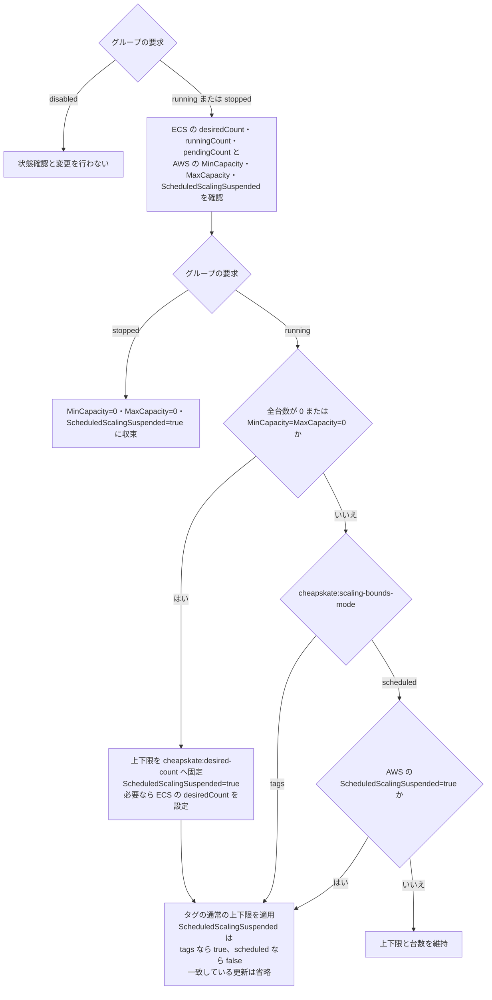

# ECS の起動・停止とスケーリング

本ドキュメントはREPLICA の ECS service を必要な時間帯に稼働させ、稼働中のスケーリング上下限を管理する機能の目的と動作を説明する。

## 機能の目的と管理範囲

cheapskate はグループのスケジュールと override に従って ECS service を起動・停止する。稼働中は負荷に応じた台数変更を許容し、起動時の台数に固定し続けない。AWS Application Auto Scaling の Scheduled Scaling は、稼働中の上下限を時刻に応じて変えるために併用できる。グループの start_cron・stop_cron は稼働時間帯、AWS の scheduled action はスケーリング上下限を管理する。

タグの上下限を常に維持する運用と、Scheduled Scaling に上下限の変更を委ねる運用を選ぶため、cheapskate:scaling-bounds-mode を設定する。Scheduled Scaling の一時停止状態は、この管理モードに応じて制御する。

| モード | 用途 | 稼働中の上下限 | 稼働中の Scheduled Scaling |
| --- | --- | --- | --- |
| tags | タグで指定した範囲を継続して維持する | cheapskate:scaling-min・cheapskate:scaling-max との差を修正する | タグの範囲との競合を防ぐため一時停止する |
| scheduled | 時刻に応じた上下限変更を AWS に委ねる | 起動の最後と一時停止解除時にタグの範囲を適用し、その後の変更を維持する | 有効にする |

Scheduled Scaling を使用しない service でタグの上下限を維持する場合も tags を選ぶ。未設定時は scheduled とする。どちらのモードも動的スケーリングの停止フラグを変更せず、通常範囲内の現在台数を維持する。tags は台数を固定するモードではない。

停止中はどちらのモードでも Scheduled Scaling を一時停止し、scheduled action による意図しない再起動を防ぐ。起動後の管理方法はタグに保持するため、日々の起動・停止をまたいで同じモードを使用できる。

### 運用例

次の例は、scalable target が登録済みで、グループの要求が running の場合である。

| 運用 | 上下限管理モード | cheapskate の動作 |
| --- | --- | --- |
| API を 1～3 台で運用 | tags | AWS の上限を次の正常サイクルで戻す |
| 昼夜で範囲を変更 | scheduled | AWS の上下限を維持する |

API service には cheapskate:scaling-min=1 と cheapskate:scaling-max=3 を設定する。上下限管理モードタグ cheapskate:scaling-bounds-mode は tags とする。AWS 側で上限を 6 に変更しても、次の正常なサイクルで上限を 3 に戻す。

昼は 4～6 台、夜は 1～2 台にする scheduled action を AWS に登録し、cheapskate:scaling-bounds-mode=scheduled を設定する。cheapskate は AWS が変更した上下限を維持し、通常のタグ範囲へ戻さない。

営業時間外に 0 台を維持する場合は、cheapskate の停止スケジュールまたは override=stopped を使用する。上下限管理モードは稼働中のスケーリング範囲を選ぶために使用する。

## 設定と現在状態

DynamoDB のグループ設定、service のタグ、および AWS の現在状態は、次のように区別する。

| 情報源 | 項目 | 用途 |
| --- | --- | --- |
| DynamoDB | start_cron、stop_cron、override、override_expires_at | 現在時刻と DEFAULT_TIMEZONE に基づき、running・stopped・disabled を決める |
| DynamoDB | ecs_max_count | cheapskate が適用する起動台数と通常の上限を検証する |
| ECS service のタグ | cheapskate:group | 所属する DynamoDB のグループ名 |
| ECS service のタグ | cheapskate:desired-count | 停止状態または上下限 0/0 からの起動台数 |
| ECS service のタグ | cheapskate:scaling-min、cheapskate:scaling-max | 起動の最後、tags モードの稼働中、および一時停止解除時の通常の上下限 |
| ECS service のタグ | cheapskate:scaling-bounds-mode | 稼働中の上下限を tags と scheduled のどちらで管理するか |
| ECS の現在状態 | desiredCount、runningCount、pendingCount | 設定台数、稼働中の台数、起動待ちの台数 |
| Application Auto Scaling の現在状態 | MinCapacity、MaxCapacity、ScheduledScalingSuspended | 適用済みの上下限と一時停止状態 |

グループの running は起動状態を維持する要求である。ECS の現在の desiredCount や、タグの起動台数と同じ意味ではない。タグの cheapskate:desired-count は稼働中の台数を常時固定する設定ではない。

DynamoDB 属性、CLI 操作、およびタグの型と既定値は、[ECS service の設定](resources/ecs-service.md) を参照。

### 上下限管理モードと AWS の一時停止フラグ

cheapskate:scaling-bounds-mode は、利用者が ECS service のタグとして指定する上下限の管理方法である。cheapskate はこのタグを自動付与・書き換えしない。

ScheduledScalingSuspended は、AWS Application Auto Scaling の scalable target に設定する一時停止フラグである。true は Scheduled Scaling の一時停止、false は有効化を表す。cheapskate はグループの要求と上下限管理モードに応じて、この AWS フラグを制御する。

scalable target が登録済みの場合の対応を、以下に示す。

| 場面 | 上下限管理モード | ScheduledScalingSuspended に適用する値 |
| --- | --- | --- |
| 稼働中（起動設定完了後） | tags | true |
| 稼働中（起動設定完了後） | scheduled | false |
| 停止要求を適用するとき | どちらのモードでも | true |
| 起動台数の初期設定中 | どちらのモードでも | true |

タグが scheduled でも、停止中と起動台数の初期設定中は AWS の ScheduledScalingSuspended=true となる。起動設定の最後に、管理モードに対応する値を適用する。グループの要求が disabled の場合、AWS フラグは変更しない。

## 停止と起動

ECS は、desiredCount・runningCount・pendingCount がすべて 0 の場合だけ停止済みとする。desiredCount の変更とタスクの起動・終了は非同期であり、設定が反映されても runningCount は後から変わる。pendingCount は起動待ちの台数であり、終了待ちの台数ではない。

### scalable target がある場合

グループが stopped を要求すると、MinCapacity=0、MaxCapacity=0、および ScheduledScalingSuspended=true を適用する。上下限管理モードにかかわらず、停止中は一時停止する。

グループが running を要求し、ECS の全台数が 0、または上下限が 0/0 の場合に起動台数を設定する。最初に上下限を cheapskate:desired-count の台数に固定し、起動設定中の上下限変更を防ぐため Scheduled Scaling を一時停止する。ECS の設定台数を再確認し、必要な場合だけ起動台数へ変更する。最後に、通常の上下限と管理モードに対応する一時停止状態を同時に適用する。

起動設定の完了は全タスクの起動完了を意味しない。設定が一致している更新は省略する。

### scalable target がない場合

停止は desiredCount=0 を設定する。起動は全台数が 0 の場合だけ、cheapskate:desired-count の台数を設定する。稼働中や起動待ちの service を起動台数へ戻す操作は行わない。scalable target は新規作成しないため、上下限管理モードは AWS の設定を変更しない。

## 稼働中のスケーリング

scalable target があり、起動台数の設定が不要な場合の動作を、以下に示す。

| 上下限管理モード | AWS の現在状態 | 動作 |
| --- | --- | --- |
| tags | 通常の上下限または一時停止に差がある | 通常の上下限と ScheduledScalingSuspended=true を適用 |
| tags | 設定が一致 | 変更しない |
| scheduled | ScheduledScalingSuspended=true | 通常の上下限と ScheduledScalingSuspended=false を適用 |
| scheduled | ScheduledScalingSuspended=false | 上下限と台数を維持 |

モードの切り替えと一時停止解除では、現在の desiredCount が通常の範囲内なら維持する。範囲外なら AWS が台数を調整する。起動台数タグへの再設定は行わない。AWS による容量調整は[RegisterScalableTarget](https://docs.aws.amazon.com/autoscaling/application/APIReference/API_RegisterScalableTarget.html) を参照。

### 一時停止の対象

上下限管理モードのタグは cheapskate によって書き換えられない。Scheduled Scaling を再開する場合は scheduled に変更し、グループの要求を running にする。

Scheduled Scaling の一時停止は、新しい scheduled action の開始を抑止する。開始済みの操作を取り消さず、一時停止期間に実行時刻を過ぎた action を再実行しない。再開後は将来の実行時刻から動作する。AWS の動作は[スケーリングの一時停止と再開](https://docs.aws.amazon.com/autoscaling/application/userguide/application-auto-scaling-suspend-resume-scaling.html) を参照。

scheduled action の定義、DynamicScalingInSuspended、および DynamicScalingOutSuspended は変更しない。各フラグの対象は[SuspendedState](https://docs.aws.amazon.com/autoscaling/application/APIReference/API_SuspendedState.html) を参照。

### 台数上限と 0 台の維持

ecs_max_count は、cheapskate が適用するタグの起動台数と通常の上限に対する検証値である。Scheduled Scaling の上下限や現在台数の絶対上限にはならない。

グループが running を要求している間に Scheduled Scaling が全台数を 0 にすると、次のサイクルは再び起動する。0 台を維持する時間帯には、cheapskate の停止スケジュールまたは stopped override を使用する。

## 要求と現在状態からの分岐

scalable target がある場合の操作決定を、次の図に示す。更新する値はタグから、停止済みかどうかと一時停止状態は AWS の現在状態から取得する。

## タグ変更と処理途中の失敗

操作に失敗した場合は、適用済みの AWS 設定を残す。次のサイクルはグループ設定、タグ、および現在状態を読み直して操作を決める。DynamoDB とタグには実行履歴や起動処理の進捗を保存しない。

正の固定範囲は通常設定としても起動途中の結果としても存在する。固定範囲だけから起動途中と推測せず、上下限管理モードと AWS の現在状態に従って通常設定を適用する。処理途中でタグを変更しても、すでに設定された台数が変更後の通常範囲内なら維持する。変更後の cheapskate:desired-count は、次の停止状態または上下限 0/0 からの起動で適用する。

後続サイクルが stopped または disabled を読み取った場合は、その要求に従う。古い起動処理の再開を理由に再起動しない。同時実行における反映の条件は、[起動・停止の挙動](resource_flow.md#失敗と同時実行) を参照。

## 設定と現在状態の具体例

### 停止状態からの起動と途中失敗

詳細な設定値と状態の推移は、[ECS の設定と現在状態の具体例](ecs_examples.md#停止状態からの起動と途中失敗)を参照。

### 稼働中の固定範囲からのタグ変更

詳細な設定値と状態の推移は、[ECS の設定と現在状態の具体例](ecs_examples.md#稼働中の固定範囲からのタグ変更)を参照。

### 一時停止解除時の範囲外台数

詳細な設定値と状態の推移は、[ECS の設定と現在状態の具体例](ecs_examples.md#一時停止解除時の範囲外台数)を参照。

### 最後の応答消失後の Scheduled Scaling

詳細な設定値と状態の推移は、[ECS の設定と現在状態の具体例](ecs_examples.md#最後の応答消失後の-scheduled-scaling)を参照。

### 起動途中からの停止要求

詳細な設定値と状態の推移は、[ECS の設定と現在状態の具体例](ecs_examples.md#起動途中からの停止要求)を参照。
