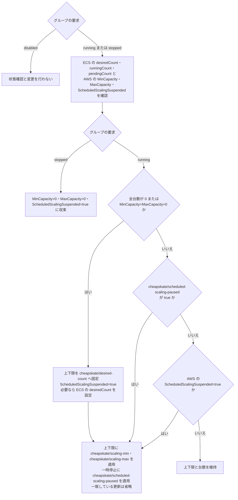

# ECS の起動・停止とスケーリング

本ドキュメントは、ECS service の起動台数、スケーリング上下限、および Scheduled Scaling の一時停止が、グループの要求と AWS の現在状態によってどう変わるかを説明する。対象は REPLICA の service である。

## 設定と現在状態

DynamoDB のグループ設定、service のタグ、および AWS の現在状態は、次のように区別する。

| 情報源 | 項目 | 用途 |
| --- | --- | --- |
| DynamoDB | start_cron、stop_cron、override、override_expires_at | 現在時刻と DEFAULT_TIMEZONE に基づき、running・stopped・disabled を決める |
| DynamoDB | ecs_max_count | cheapskate が適用する起動台数と通常の上限を検証する |
| ECS service のタグ | cheapskate:group | 所属する DynamoDB のグループ名 |
| ECS service のタグ | cheapskate/desired-count | 停止状態または上下限 0/0 からの起動台数 |
| ECS service のタグ | cheapskate/scaling-min、cheapskate/scaling-max | 起動の最後、一時停止中、および一時停止解除時の通常の上下限 |
| ECS service のタグ | cheapskate/scheduled-scaling-paused | Scheduled Scaling の一時停止要求 |
| ECS の現在状態 | desiredCount、runningCount、pendingCount | 設定台数、稼働中の台数、起動待ちの台数 |
| Application Auto Scaling の現在状態 | MinCapacity、MaxCapacity、ScheduledScalingSuspended | 適用済みの上下限と一時停止状態 |

グループの running は起動状態を維持する要求である。ECS の現在の desiredCount や、タグの起動台数と同じ意味ではない。タグの cheapskate/desired-count は、稼働中の台数を常時固定する設定ではない。

DynamoDB 属性、CLI 操作、およびタグの型と既定値は、[ECS service の設定](resources/ecs-service.md) を参照。

## 停止と起動

ECS は、desiredCount・runningCount・pendingCount がすべて 0 の場合だけ停止済みとする。desiredCount の変更とタスクの起動・終了は非同期であり、設定が反映されても runningCount は後から変わる。pendingCount は起動待ちの台数であり、終了待ちの台数ではない。

### scalable target がある場合

グループが stopped を要求すると、MinCapacity=0、MaxCapacity=0、および ScheduledScalingSuspended=true を適用する。タグの一時停止要求が false でも、停止中は一時停止する。

グループが running を要求し、ECS の全台数が 0、または上下限が 0/0 の場合に起動台数を設定する。最初に上下限を cheapskate/desired-count の台数に固定し、Scheduled Scaling を一時停止する。ECS の設定台数を再確認し、必要な場合だけ起動台数へ変更する。最後に、通常の上下限とタグの一時停止要求を同時に適用する。

起動設定の完了は、全タスクの起動完了を意味しない。設定が一致している更新は省略する。

### scalable target がない場合

停止は desiredCount=0 を設定する。起動は全台数が 0 の場合だけ、cheapskate/desired-count の台数を設定する。稼働中や起動待ちの service を起動台数へ戻す操作は行わない。scalable target は新規作成しない。

## 稼働中のスケーリング

scalable target があり、起動台数の設定が不要な場合の動作を、以下に示す。

| タグの一時停止要求 | AWS の現在状態 | 動作 |
| --- | --- | --- |
| true | 通常の上下限または一時停止に差がある | 通常の上下限と ScheduledScalingSuspended=true を適用 |
| true | 設定が一致 | 変更しない |
| false または未設定 | ScheduledScalingSuspended=true | 通常の上下限と ScheduledScalingSuspended=false を適用 |
| false または未設定 | ScheduledScalingSuspended=false | 上下限と台数を維持 |

一時停止の適用と解除では、現在の desiredCount が通常の範囲内なら維持する。範囲外なら AWS が台数を調整する。起動台数タグへの再設定は行わない。AWS による容量調整は、[RegisterScalableTarget](https://docs.aws.amazon.com/autoscaling/application/APIReference/API_RegisterScalableTarget.html)を参照。

一時停止解除後は、Scheduled Scaling が変更した上下限と台数を維持する。通常のタグ範囲を継続して維持する場合は、Scheduled Scaling を使用しない service も含めて、一時停止要求を true にする。

### 一時停止の対象

cheapskate/scheduled-scaling-paused=true は、service の起動・停止をまたいで保持する要求である。タグは cheapskate によって書き換えられない。解除はタグを false に変更するか削除する操作で行う。

Scheduled Scaling の一時停止は、新しい scheduled action の開始を抑止する。開始済みの操作を取り消さず、一時停止期間に実行時刻を過ぎた action を再実行しない。再開後は将来の実行時刻から動作する。AWS の動作は、[スケーリングの一時停止と再開](https://docs.aws.amazon.com/autoscaling/application/userguide/application-auto-scaling-suspend-resume-scaling.html)を参照。

scheduled action の定義、DynamicScalingInSuspended、および DynamicScalingOutSuspended は変更しない。各フラグの対象は、[SuspendedState](https://docs.aws.amazon.com/autoscaling/application/APIReference/API_SuspendedState.html)を参照。

### 台数上限と 0 台の維持

ecs_max_count は、cheapskate が適用するタグの起動台数と通常の上限に対する検証値である。Scheduled Scaling の上下限や現在台数の絶対上限にはならない。

グループが running を要求している間に Scheduled Scaling が全台数を 0 にすると、次のサイクルは再び起動する。0 台を維持する時間帯には、cheapskate の停止スケジュールまたは stopped override を使用する。

## 要求と現在状態からの分岐

scalable target がある場合の操作決定を、次の図に示す。更新する値はタグから、停止済みかどうかと一時停止状態は AWS の現在状態から取得する。

## タグ変更と処理途中の失敗

操作に失敗した場合は、適用済みの AWS 設定を残す。次のサイクルはグループ設定、タグ、および現在状態を読み直して操作を決める。DynamoDB とタグには、実行履歴や起動処理の進捗を保存しない。

正の固定範囲は、通常設定としても起動途中の結果としても存在する。固定範囲だけから起動途中と推測せず、通常の上下限と一時停止要求を適用する。処理途中でタグを変更しても、すでに設定された台数が変更後の通常範囲内なら維持する。変更後の cheapskate/desired-count は、次の停止状態または上下限 0/0 からの起動で適用する。

後続サイクルが stopped または disabled を読み取った場合は、その要求に従う。古い起動処理の再開を理由に再起動しない。同時実行における反映の条件は、[起動・停止の挙動](resource_flow.md#失敗と同時実行)を参照。

## 設定と現在状態の具体例

以下の例は、cluster が dev、service が api で、scalable target が登録済みの場合である。DynamoDB の ecs_max_count は Number 型、他の属性とタグ値は String 型とする。override_expires_at は登録せず、override は無期限とする。停止の例では override を stopped に変更する。DynamoDB のグループアイテムに登録する属性値を、以下に示す。

| DynamoDB の属性 | 登録値 |
| --- | --- |
| pk | CONFIG |
| sk | GROUP#dev |
| override | running |
| ecs_max_count | 3 |

個別に変更を示す例を除き、ECS service に登録するタグ値は次のとおりである。

| ECS service のタグ | 登録値 |
| --- | --- |
| cheapskate:group | dev |
| cheapskate/desired-count | 2 |
| cheapskate/scaling-min | 1 |
| cheapskate/scaling-max | 3 |
| cheapskate/scheduled-scaling-paused | false |

以下の状態表は、各時点で AWS から取得しうる観測例である。

### 停止状態からの起動と途中失敗

DynamoDB の override=running により起動要求を選択する。ECS の全台数と AWS の上下限が 0 のため、AWS の設定に MinCapacity=2、MaxCapacity=2、および ScheduledScalingSuspended=true を適用する。台数固定後の状態取得が失敗し、通常の上下限を適用する前に処理を終了した場合の観測例を、以下に示す。

| 時点 | desiredCount | runningCount | pendingCount | MinCapacity | MaxCapacity | ScheduledScalingSuspended | 実際の ECS 状況 |
| --- | --- | --- | --- | --- | --- | --- | --- |
| 起動前 | 0 | 0 | 0 | 0 | 0 | true | タスクがなく、停止設定が残っている |
| 台数固定の適用後に失敗 | 2 | 0 | 2 | 2 | 2 | true | 2 台が起動待ちで、稼働タスクはまだない |
| 次のサイクルで通常設定を適用 | 2 | 1 | 1 | 1 | 3 | false | 1 台が稼働し、残り 1 台が起動待ちである |
| タスク起動後 | 2 | 2 | 0 | 1 | 3 | false | 2 台が稼働している |

次のサイクルでは desiredCount が正で上下限も 0/0 ではないため、起動台数への固定は繰り返さない。AWS の設定に MinCapacity=1、MaxCapacity=3、および ScheduledScalingSuspended=false を適用し、起動台数への再設定は行わない。通常設定の適用時にタスクがすべて起動済みである必要はない。

### 稼働中の固定範囲からのタグ変更

DynamoDB の登録値は override=running、ecs_max_count=3 とする。ECS service の所属タグは cheapskate:group=dev のままとし、他のタグを次のように変更する。

| ECS service のタグ | 変更前 | 変更後 |
| --- | --- | --- |
| cheapskate/desired-count | 2 | 1 |
| cheapskate/scaling-min | 2 | 1 |
| cheapskate/scaling-max | 2 | 3 |
| cheapskate/scheduled-scaling-paused | true | true |

AWS の設定に MinCapacity=1、MaxCapacity=3、および ScheduledScalingSuspended=true を適用する。AWS の現在台数を維持して上下限を変更する観測例を、以下に示す。

| 時点 | desiredCount | runningCount | pendingCount | MinCapacity | MaxCapacity | ScheduledScalingSuspended | 実際の ECS 状況 |
| --- | --- | --- | --- | --- | --- | --- | --- |
| タグ変更後、設定適用前 | 2 | 2 | 0 | 2 | 2 | true | 固定範囲で 2 台が稼働している |
| 通常の上下限を適用後 | 2 | 2 | 0 | 1 | 3 | true | 稼働中の 2 台を維持している |

AWS のタスク数がすべて 0 でも上下限が 0/0 でもないため、cheapskate/desired-count=1 を適用する起動処理には入らない。現在の desiredCount=2 は変更後の通常範囲 1..3 に収まるため、台数変更を行わない。これと同じ AWS の状態が起動途中の失敗で残った場合にも、同じ操作を適用する。

### 一時停止解除時の範囲外台数

DynamoDB の登録値は override=running、ecs_max_count=3 とする。ECS service のタグは共通設定とし、cheapskate/scheduled-scaling-paused=false を要求する。AWS の設定に MinCapacity=1、MaxCapacity=3、および ScheduledScalingSuspended=false を適用する。AWS には以前の上下限 4..6 と一時停止が残り、5 台が稼働している場合の観測例を、以下に示す。

| 時点 | desiredCount | runningCount | pendingCount | MinCapacity | MaxCapacity | ScheduledScalingSuspended | 実際の ECS 状況 |
| --- | --- | --- | --- | --- | --- | --- | --- |
| 一時停止解除前 | 5 | 5 | 0 | 4 | 6 | true | 5 台が稼働している |
| 通常範囲と解除を適用後 | 3 | 5 | 0 | 1 | 3 | false | 設定台数は 3 台となり、余剰タスクの終了前には 5 台が稼働している |
| タスク終了後 | 3 | 3 | 0 | 1 | 3 | false | 3 台が稼働している |

cheapskate/scaling-min=1 と cheapskate/scaling-max=3 を適用するため、AWS が設定台数を範囲内の 3 台へ調整する。cheapskate/desired-count=2 への再設定は行わない。

### 最後の応答消失後の Scheduled Scaling

DynamoDB とタグは共通設定とする。AWS への MinCapacity=1、MaxCapacity=3、および ScheduledScalingSuspended=false の適用は成功したが、その応答だけが失われた場合を示す。その後、AWS の scheduled action が上下限を 4..6 に変更し、台数が増えた場合の観測例を、以下に示す。

| 時点 | desiredCount | runningCount | pendingCount | MinCapacity | MaxCapacity | ScheduledScalingSuspended | 実際の ECS 状況 |
| --- | --- | --- | --- | --- | --- | --- | --- |
| 最後の更新が成功し、応答が消失 | 2 | 2 | 0 | 1 | 3 | false | 2 台が稼働し、Scheduled Scaling が有効である |
| scheduled action による変更後 | 4 | 2 | 2 | 4 | 6 | false | 設定台数が下限の 4 台へ増え、2 台が起動待ちである |
| 次のサイクル | 4 | 4 | 0 | 4 | 6 | false | 4 台が稼働している |

次のサイクルでは、cheapskate/scheduled-scaling-paused タグと AWS の ScheduledScalingSuspended がともに false のため、設定を変更しない。タグの通常範囲 1..3 や起動台数 2 へ戻さない。DynamoDB の ecs_max_count=3 は cheapskate が適用する起動台数とタグの上限の検証値であり、scheduled action の上下限や現在台数を制限する値ではない。

### 起動途中からの停止要求

DynamoDB のグループアイテムの override を running から stopped に変更する。ecs_max_count=3 と ECS service の共通タグは変更しない。AWS の設定に MinCapacity=0、MaxCapacity=0、および ScheduledScalingSuspended=true を適用する。起動待ちのタスクがある状態から停止する観測例を、以下に示す。

| 時点 | desiredCount | runningCount | pendingCount | MinCapacity | MaxCapacity | ScheduledScalingSuspended | 実際の ECS 状況 |
| --- | --- | --- | --- | --- | --- | --- | --- |
| 停止要求の適用前 | 2 | 1 | 1 | 2 | 2 | true | 1 台が稼働し、1 台が起動待ちである |
| 停止設定の適用後 | 0 | 1 | 0 | 0 | 0 | true | 起動待ちタスクは取り消され、稼働タスクの終了待ちである |
| タスク終了後 | 0 | 0 | 0 | 0 | 0 | true | 稼働中と起動待ちのタスクがなく、停止設定が成立している |

停止要求はタグの起動台数 2 と一時停止要求 false より優先される。通常の上下限 1..3 を適用する起動復旧は行わない。DynamoDB の override を disabled に変更した場合は AWS の観測と変更を行わず、その時点の AWS 設定を残す。
