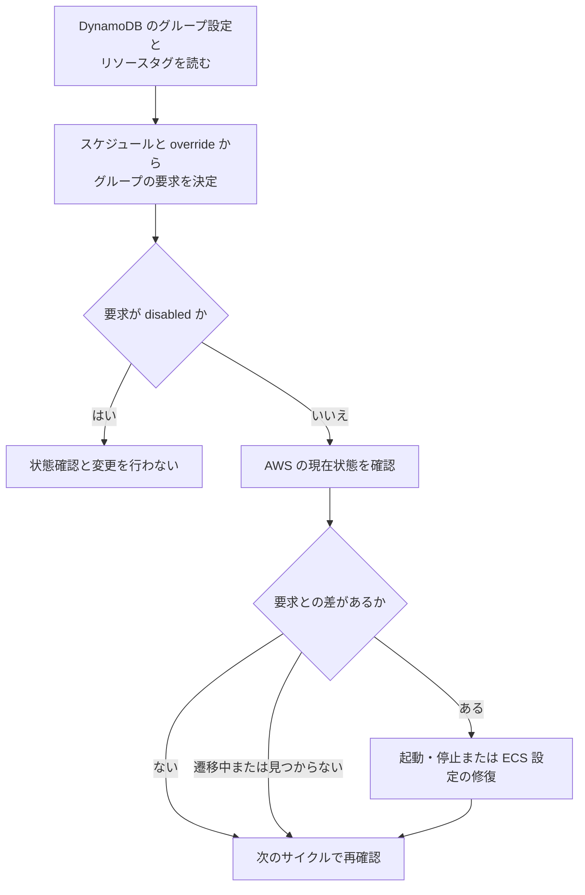

# 起動・停止の挙動

本ドキュメントは、設定の反映タイミング、定期的な状態確認、およびリソース種別ごとの起動・停止の意味を説明する。

## 設定の反映タイミング

reconciler は、通常 5 分間隔で、全グループの設定とタグ付きリソースを読み込む。設定変更は、それを読み取った正常なサイクルで反映する。設定コマンドの成功時点で AWS リソースが変わるわけではない。

各サイクルは、その時点で要求される状態と AWS の現在状態を比較する。起動・停止を開始した後は、遷移の完了を待たずに処理を終える。以降のサイクルで状態を確認する。基本的な処理を、次の図に示す。

RDS と EC2 は遷移中の操作を見送る。ECS はタスクの起動・終了が進行中でも、停止要求やスケーリング設定を適用する。

## 対応リソースと操作の意味

対象条件と、起動・停止によって変わる内容を、以下に示す。

| リソース | 対象条件 | 起動 | 停止 |
| --- | --- | --- | --- |
| RDS DB インスタンス | DB クラスタに所属せず、RDS Custom 以外 | インスタンスを起動 | インスタンスを停止 |
| Aurora DB クラスタ | engine が aurora で始まる | クラスタを起動 | クラスタを停止 |
| EC2 インスタンス | Auto Scaling グループに所属しない | インスタンスを起動 | インスタンスを停止 |
| ECS service | REPLICA、長形式の ARN | 起動台数とスケーリング設定を適用 | desiredCount と登録済みの上下限を 0 にし、Scheduled Scaling を一時停止 |

RDS DB インスタンスと Aurora DB クラスタは、available を稼働中、stopped を停止済みとして扱う。他の状態では次のサイクルまで待つ。Aurora の所属 DB インスタンスを個別の停止対象にしないこと。

EC2 は running を稼働中、stopped を停止済みとして扱う。terminated は見つからない状態として扱い、再起動しない。

ECS のタスク数、通常の上下限、および一時停止の関係は、[ECS の起動・停止とスケーリング](ecs.md)を参照。

## 手動変更と管理の一時停止

管理中にリソースを手動で起動・停止すると、後続サイクルはグループの要求へ戻す。手動操作を維持したい場合は、先に disabled override を設定すること。

cheapskate 自体の実行停止、disabled、所属タグの削除、およびグループの削除は、その時点の AWS 設定を残す。ECS の上下限や一時停止フラグを自動で復元しない。管理を終了する手順は、[日常の操作](operations.md#管理の終了)を参照。

## 失敗と同時実行

全グループまたはリソース一覧の読み込みに失敗したサイクルでは、リソースの状態確認と変更を行わない。グループ設定や個別リソースのエラーでは、他のリソースの処理を続ける。失敗した操作は、以降のサイクルで設定と現在状態を読み直して判断する。

同時実行や再試行によって同じ操作が複数回行われることがある。古い設定を取得した実行が、変更後も一時的に古い要求を適用する場合がある。古い実行が終了し、設定が安定し、AWS API が成功する条件で、後続サイクルが最新設定へ収束させる。失敗が続く場合、反映時間の上限はない。

操作の成功は AWS が要求を受け付けたことを表し、リソースの起動・停止完了を表さない。確認方法は、[ログ・メトリクス・通知](monitoring.md)を参照。
